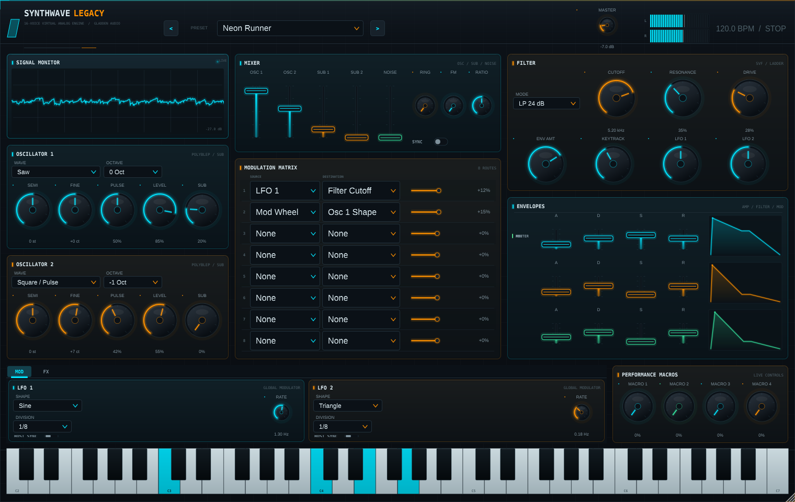
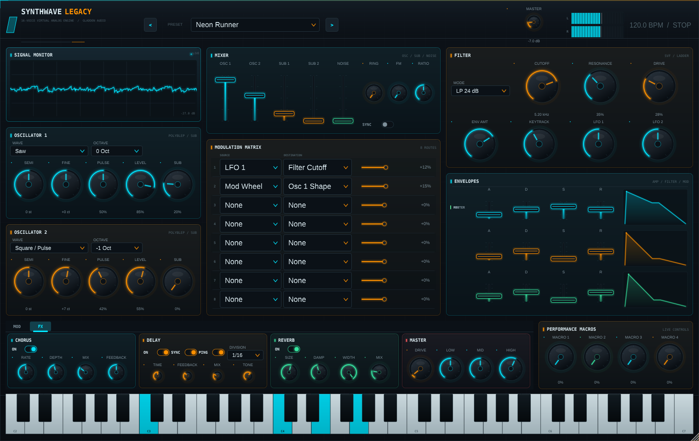

# Synthwave Legacy

A complete 16-voice virtual-analog instrument for JUCE 7.0.12, built as a VST3/AU/Standalone plugin with a fully custom dark sci-fi interface.



## What is included

- **16-voice polyphonic synthesiser** built on `juce::Synthesiser`, with note stealing and sustain-pedal handling.
- **Two virtual-analog oscillators** with PolyBLEP band-limited saw, pulse/PWM, triangle and sine, plus a sine sub-oscillator per oscillator.
- **Hard sync, ring modulation and FM** between the oscillators.
- **Two filter engines per voice**:
  - `juce::dsp::StateVariableTPTFilter` for 12 dB low/high/band-pass and notch.
  - `juce::dsp::LadderFilter` for 24 dB low/high/band-pass and notch.
  - 12/24 dB notch is implemented as a phase-correct low-pass + high-pass sum.
  - Per-voice drive/saturation, filter envelope amount, key tracking and dedicated LFO 1/2 depth.
- **Three ADSR envelopes per voice**: amp, filter and modulation. JUCE 7 does not provide `juce::dsp::EnvelopeGenerator`, so an allocation-free ADSR implementation is used.
- **Two global LFOs** with sine, triangle, saw, square and sample-and-hold shapes, free rate or host-tempo sync.
- **Eight-slot modulation matrix** with LFO 1/2, amp/filter/mod envelopes, velocity, mod wheel, aftertouch, keytrack and macros as sources. Destinations include both oscillators' pitch/shape, filter cutoff/resonance, mixer volume, pan and the FX parameters.
- **Serial stereo FX chain**:
  1. `juce::dsp::Chorus`
  2. Modulated stereo delay with ping-pong and host-tempo sync
  3. `juce::dsp::Reverb`
  4. Master drive/saturation
  5. Three-band output EQ
  6. Smoothed master gain with output protection, peak meters and scope
- **Fully bound editor** using APVTS `SliderAttachment`, `ComboBoxAttachment` and `ButtonAttachment` throughout.
- **Custom LookAndFeel** with matte charcoal, teal (`#00E5FF`) and amber (`#FF9100`) accents, glass panels, glowing arcs, custom meters, scope and an extended 61-key keyboard.
- **Factory preset browser** with eight presets.
- **Persistent state** through `AudioProcessorValueTreeState::copyState()` / `replaceState()`.

## Interface

| MOD tab | FX tab |
| --- | --- |
|  |  |

The layout is resizable. A snapshot of the minimum supported size (1180 x 800) is in [Preview/SynthwaveLegacy_small.png](Preview/SynthwaveLegacy_small.png).

### Performance macro assignments

The macro knobs can also be used as modulation-matrix sources. In addition, they always map to:

| Macro | Hard-wired destination |
| --- | --- |
| Macro 1 | Filter cutoff (+3 octaves) |
| Macro 2 | Reverb mix |
| Macro 3 | Chorus mix/depth |
| Macro 4 | Master drive |

### Factory presets

| Program | Character |
| --- | --- |
| Init Patch | Neutral starting point |
| Neon Runner | Bright detuned saw/pulse with tempo delay |
| Midnight Chase | Dark pulse, resonant low-pass and ping-pong echoes |
| Blade Horizon | Slow, wide detuned pad with ensemble and reverb |
| Outrun Sunset | Hard-synced lead with short delay |
| Glass City | FM/ring-mod bell with long reverb |
| Analog Dream | Warm filtered saw pad |
| Sub Zero | Focused sub bass |

## Build

Requirements:

- CMake 3.22 or newer
- C++20 compiler
- JUCE 7.0.12 (fetched automatically unless a local checkout is supplied)

### Linux dependencies

```bash
sudo apt update
sudo apt install build-essential cmake git \
    libasound2-dev libfreetype-dev libfontconfig1-dev \
    libx11-dev libxcomposite-dev libxcursor-dev libxext-dev \
    libxinerama-dev libxrandr-dev libxrender-dev libgl1-mesa-dev
```

Web-browser and libcurl support are intentionally disabled, so WebKit and libcurl development packages are not required.

### Configure and build

```bash
cmake -S . -B build -DCMAKE_BUILD_TYPE=Release
cmake --build build --config Release -j
```

By default CMake fetches the pinned JUCE 7.0.12 source. For an offline build or an existing JUCE checkout:

```bash
cmake -S . -B build -DCMAKE_BUILD_TYPE=Release \
      -DSYNTHWAVE_JUCE_DIR=/path/to/JUCE
```

Artifacts are placed under:

- `build/SynthwaveLegacy_artefacts/Release/VST3/Synthwave Legacy.vst3`
- `build/SynthwaveLegacy_artefacts/Release/Standalone/Synthwave Legacy`
- `build/SynthwaveLegacy_artefacts/Release/AU/Synthwave Legacy.component` on macOS

On macOS, AU is included in the generated formats. On Linux, VST3 and Standalone are built.

## Tests

```bash
cmake -S . -B build -DSYNTHWAVE_BUILD_TESTS=ON -DCMAKE_BUILD_TYPE=Debug
cmake --build build --target SynthwaveLegacyTests -j
ctest --test-dir build --output-on-failure
```

The smoke test checks:

- finite output across 16-voice playback;
- all eight factory presets and all eight filter modes;
- state round-tripping for every parameter;
- state restoration one parameter at a time;
- an optional editor render.

Optional visual / audio verification:

```bash
./build/SynthwaveLegacyTests_artefacts/Debug/SynthwaveLegacyTests \
    --gui-snapshot "$PWD/Preview/SynthwaveLegacy.png"

./build/SynthwaveLegacyTests_artefacts/Debug/SynthwaveLegacyTests \
    --render-demo "$PWD/Preview/demo.wav"
```

`--gui-snapshot` writes the main view, the FX view and a 1180 x 800 responsive-layout view.

### pluginval

The built VST3 was validated with pluginval v1.0.4 at strictness level 6, including editor tests:

```bash
pluginval --validate "build/SynthwaveLegacy_artefacts/Debug/VST3/Synthwave Legacy.vst3" \
          --strictness-level 6
```

Result: **SUCCESS, 99/99 tests**.

## Architecture

```
MIDI / virtual keyboard
        │
        ▼
  Synthesiser (16 voices)
        │  per voice:
        │  PolyBLEP osc 1/2 + sine sub
        │  sync / ring / FM
        │  SVF or ladder filter + drive
        │  amp / filter / mod ADSR
        │  8-slot mod matrix
        ▼
  Chorus → Ping-pong stereo delay → Reverb
        ▼
  Master drive → 3-band EQ → smoothed gain → safety limit
        ▼
  Atomic L/R peak meters + AbstractFifo scope
```

### Real-time safety

- Every DSP object, delay line, chorus, reverb and buffer is prepared in `prepareToPlay()`.
- The audio path has no heap allocations, locks, `String` construction, file I/O or object creation.
- Parameter values are read through cached `std::atomic<float>*` pointers.
- Modulation sources and destinations use fixed-size stack arrays.
- MIDI scratch storage is pre-sized; the synthesiser renders into caller-owned buffers.
- L/R metering uses `std::atomic<float>`; the scope uses `juce::AbstractFifo`.
- Filter coefficients are recalculated allocation-free at a 6 kHz control rate inside the voice, because audio-rate cutoff modulation cannot be baked at prepare time. This is the only intentional departure from a literal “coefficients only in prepare” interpretation.

### File map

| File | Responsibility |
| --- | --- |
| `Source/Parameters.*` | APVTS layout, choice lists, sync helpers |
| `Source/SynthVoice.*` | PolyBLEP oscillator, sub, ADSR, filters, per-voice modulation and rendering |
| `Source/DSP.*` | Oscillator, ADSR, global LFO, ladder wrapper, biquad and filter utilities |
| `Source/PluginProcessor.*` | 16-voice synth, FX chain, MIDI/playhead handling, state, meters, scope |
| `Source/Presets.*` | Factory preset definitions and application |
| `Source/LookAndFeel.*` | Custom look-and-feel and panel painting |
| `Source/UIComponents.*` | Parameter-bound knobs/choices/faders/toggles, meters and scope |
| `Source/PluginEditor.*` | Responsive FlexBox layout and all panels |
| `Tests/SmokeTest.cpp` | DSP, state, preset and GUI smoke coverage |

## Notes

- The project is pinned to JUCE 7.0.12. JUCE licensing is separate from this project; see the JUCE repository for its GPL/commercial licensing terms.
- The preset browser only ships factory presets. The APVTS state, including the selected factory preset, is saved and restored with the host project.
- The virtual keyboard spans MIDI notes 36–96 (61 keys, C2–C7).
